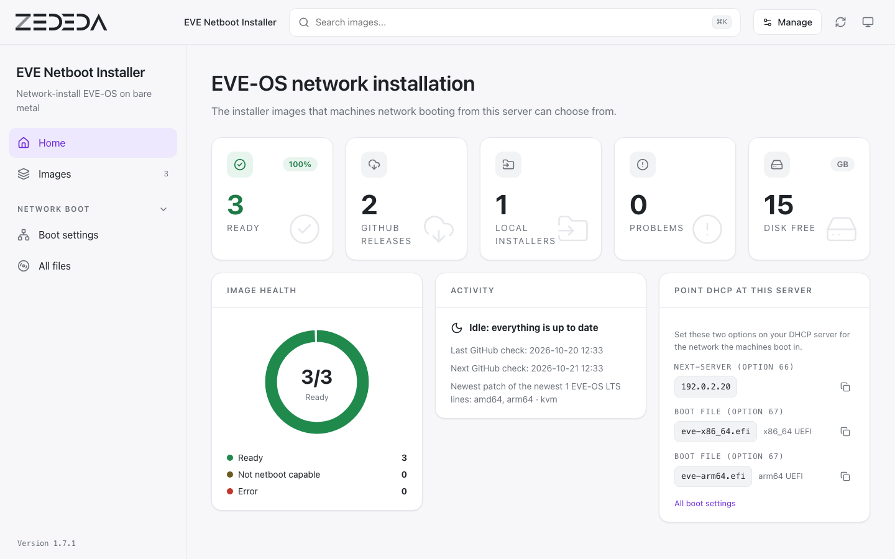
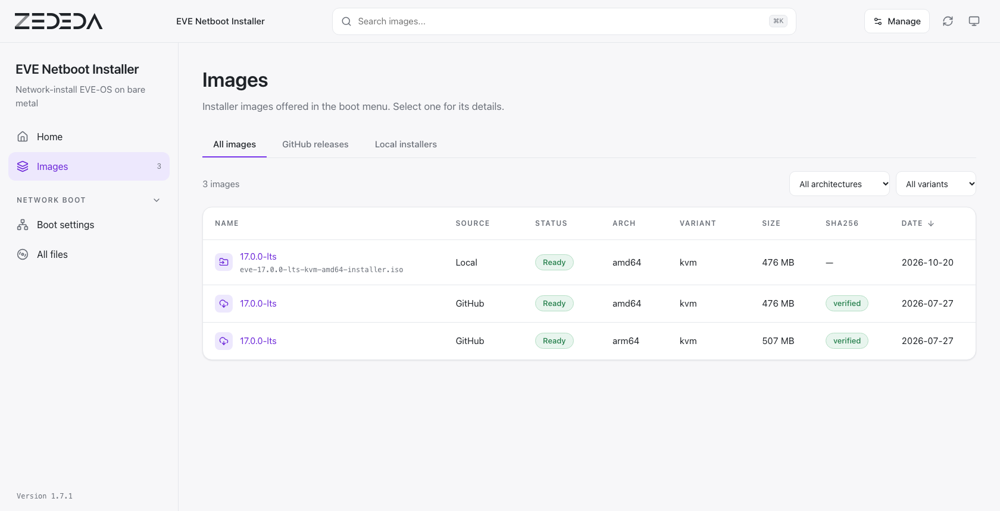
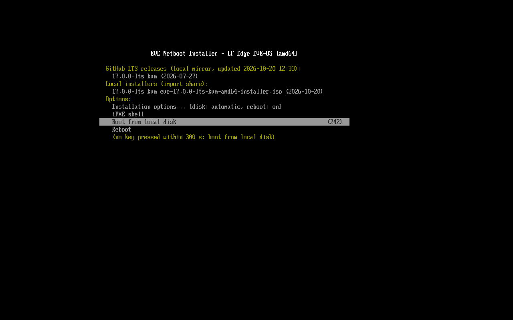
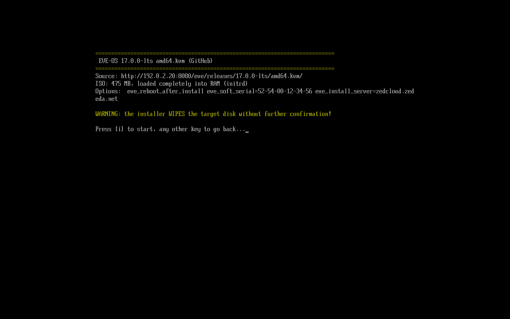
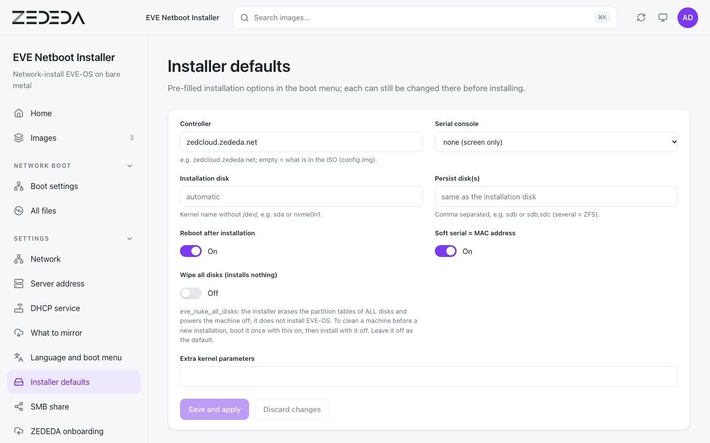
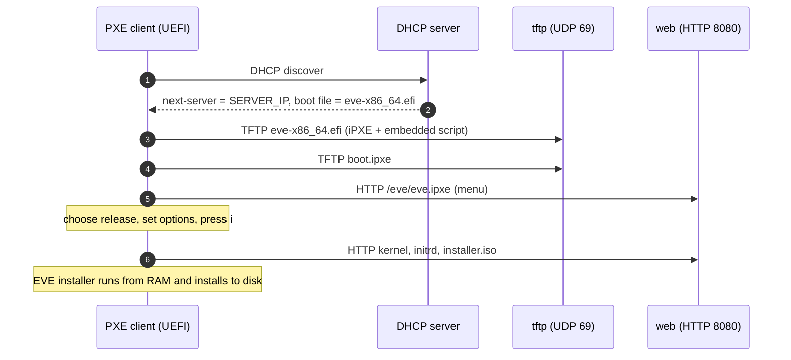
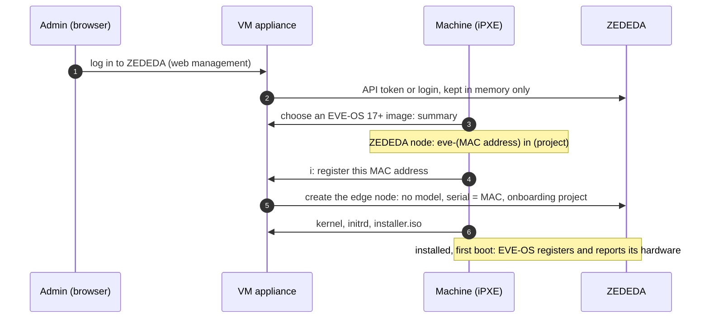

<div align="center">

# EVE Netboot Installer

**Network-install [LF Edge EVE-OS](https://github.com/lf-edge/eve) on bare metal: PXE boot, pick a release, press `i`.**

[](LICENSE)
[](https://github.com/michiel-zededa/eve-netboot-installer/actions/workflows/image.yml)
[](https://github.com/michiel-zededa/eve-netboot-installer/actions/workflows/test.yml)


</div>

EVE Netboot Installer is a self-contained PXE boot server for EVE-OS. Run it in one of two ways:

- **Ready-made VM appliance** (qcow2, OVA, VMDK) for any hypervisor, including ZEDEDA / EVE-OS, Proxmox, KVM and VMware. Set it up on its screen, in a browser or through cloud-init; no Linux knowledge needed. See [vm/README.md](vm/README.md).
- **Docker Compose stack** on any Linux host or NAS. See [docs/deployment.md](docs/deployment.md).

What it does:

- **Keeps a mirror up to date:** a local mirror of the latest EVE-OS LTS releases.
- **Includes your own builds:** it adds your own installer ISOs, such as controller-specific builds.
- **Serves one boot menu:** everything is offered in a single iPXE menu. No USB sticks, no BMC virtual media, no per-release fiddling.
- **Onboards them in ZEDEDA** *(VM appliance)*: install many machines at once and have them registered in ZEDEDA in the same go, without looking up a single serial number. For EVE-OS 17.0.0-lts and later.

```text
 LF Edge EVE-OS
 GitHub LTS releases (local mirror, updated 2026-10-05 11:27):
     17.0.6-lts  kvm  (2026-09-18)
     16.0.4-lts  kvm  (2026-08-27)
     14.5.5-lts  kvm  (2026-06-30)
 Local installers (import folder):
     zedcloud-17.0.6-kvm-amd64.iso  (2026-10-03 14:12)
 Options:
     Installation options...  [disk: automatic, reboot: on]
     iPXE shell
     Boot from local disk
     Reboot
     (no key pressed within 300 s: boot from local disk)
```

## Screenshots

All taken in a documentation network (`192.0.2.0/24`).

| | |
|---|---|
|  |  |
| **Web UI:** the images, the activity and the DHCP settings at a glance; light, [dark](docs/images/web-home-dark.png) or system theme. | **Images:** the GitHub mirror and your own ISOs, with the details of each. |
|  |  |
| **Boot menu** on the machine, in the look of EVE-OS's own console. | **Confirmation** before installing, with the options and a warning. |
|  |  |
| **VM appliance console:** status with tabs, coloured states, the keys and a clock. | **Web management** of the VM: the same settings as its console menu. |
|  |  |
| **ZEDEDA onboarding:** the machines of a staging bench, their nodes and whether they came online. | **Onboarding in the boot menu:** the node's name from the naming convention, before **`i`**. |

---

## Contents

- [Screenshots](#screenshots)
- [Features](#features)
- [How it works](#how-it-works)
- [Requirements](#requirements)
- [Quick start](#quick-start)
- [Deployment options](#deployment-options)
- [Configuration](#configuration)
- [DHCP](#dhcp)
- [Your own installer ISOs](#your-own-installer-isos)
- [Operation](#operation)
- [Languages](#languages)
- [Security considerations](#security-considerations)
- [Limitations](#limitations)
- [Repository layout](#repository-layout)
- [Contributing](#contributing)
- [License](#license)

## Features

| | |
|---|---|
| **Always current** | Mirrors the newest patch release of the newest *N* EVE-OS **LTS** lines from GitHub, for `amd64`/`arm64` and the `kvm`/`k` variants. It verifies every download against its sha256 and removes releases you no longer need. |
| **Bring your own installer** | Every EVE installer ISO (volume id `EVEISO`) in the import folder appears in the menu within a minute. This includes controller-specific builds with onboarding certificates in `config.img`. |
| **All installer options at boot** | Set them at boot: target disk, persist disk(s), controller (`eve_install_server`), serial console, soft serial, reboot after install, wipe all disks (EVE-OS then wipes every disk and powers off without installing), debug/pause, and extra kernel arguments. Defaults come from `.env`. |
| **Safe by default** | A summary screen requires an explicit **`i`** before installing. Without input, the menu falls back to the local disk after a timeout, so a machine that PXE boots by accident never stalls. |
| **Own iPXE build** | iPXE (x86_64 and arm64 UEFI) is compiled from the official sources during the image build. Only two DHCP options are needed, with no other boot infrastructure. |
| **Web UI** | A web interface in the look of the ZEDEDA UI (light, dark or system theme): the available images from the GitHub mirror and the import folder with their details (size, checksum, kernel command line, own controller configuration, errors), live download progress, and the DHCP and boot settings. Read-only on port 8080; also available as JSON. |
| **Multilingual** | Boot menu, web UI and the VM's console and web management in English, German, French, Spanish, Portuguese, Dutch, Danish and Norwegian. |
| **One `.env` file** | Every setting lives in `.env`. It is portable across plain Docker, NAS compose plugins and VMs. |
| **Ready-made VM** | A VM appliance (qcow2 for amd64/arm64, OVA for VMware): set up on its screen, in a browser or through cloud-init; web management over HTTPS (settings, ISO upload, logs, updates, diagnostics, network changes with automatic rollback); an optional DHCP service of its own (proxyDHCP next to your DHCP server, or a full DHCP server for an isolated network); automatic security updates and app updates with rollback. |
| **ZEDEDA onboarding** | VM appliance: install many machines at once and have them onboarded in ZEDEDA in the same go, without looking up serial numbers. Every machine gets its MAC address as soft serial; when you press **`i`**, the VM creates its edge node in an onboarding project, from where you move it to its own project once it is online. The node is created without a model, so **only for EVE-OS 17.0.0-lts and later**, which report their own hardware; the option appears only in the summary of those images. Node names follow a naming convention with the MAC address, the hardware serial or a sequence number (`bench1-node-{n:3}`), or are typed per machine in the boot menu. You log in to ZEDEDA in the web management or the console; the session is kept in memory only. The list of onboarded machines shows each node's state in ZEDEDA; it can be exported and imported as CSV, cleaned up, and nodes can be deleted again from the appliance, one by one or several at once. See [ZEDEDA onboarding](#zededa-onboarding). |

## How it works



The stack consists of one image in three roles:

| Service | Role |
|---|---|
| `sync` | Mirrors GitHub releases, scans the import folder, generates the iPXE menu and `boot.ipxe`, and installs the web UI with its data. |
| `tftp` | Serves the iPXE binaries and `boot.ipxe` (host networking, UDP 69). |
| `web` | nginx: menu, kernels, initrds, ISOs and the web UI. |

### Why not `sanboot` the ISO?

The EVE installer searches for its ISO again once Linux is running, and a SAN-emulated CD-ROM is gone by then. EVE's own netboot path therefore puts the whole ISO *inside* the initrd and boots with `root=/installer.iso`. EVE Netboot Installer reproduces exactly that kernel command line, parsed from each ISO's own `grub.cfg`, and drives it from iPXE.

See [docs/how-it-works.md](docs/how-it-works.md) for the details.

### ZEDEDA onboarding

*VM appliance, EVE-OS 17.0.0-lts and later.* Normally every node
has to be added in ZEDEDA with its serial number: the hardware serial from a
label or the BIOS, or a soft serial, for which you have to know which soft
serial ended up on which machine. With onboarding switched on, the boot server
does it while the machines install:



1. The boot menu gives every machine its **MAC address as soft serial**
   (`eve_soft_serial`, on by default), so the VM knows the serial when the
   machine boots.
2. When you press **`i`**, the VM creates the edge node **without a model**
   (EVE-OS 17 and later report their own hardware) in one **onboarding
   project**. A machine installed again gets no second node.
3. The node's name follows your naming convention: the MAC address, the
   hardware serial or a sequence number (`bench1-node-{n:3}` gives
   `bench1-node-001`, `-002`, … for the machines of a staging bench), or a
   name typed for that machine in the boot menu. ZEDEDA cannot rename a node
   later, so it is fixed at installation.
4. After the installation EVE-OS registers, comes online and reports its
   adapters. You assign them to network instances and move the node to the
   project it belongs in.
5. The web management and the console list which MAC address, hardware
   serial and product became which node; the list can be exported as CSV,
   and a node created by mistake can be deleted again.

The summary of an EVE-OS 17+ image shows the node name and the options
**Onboard in ZEDEDA [o]** (on by default) and **Node name [n]** next to
**Install now [i]**; older images are installed as before, without onboarding. Setup and use:
[vm/README.md: Onboard installed machines in ZEDEDA](vm/README.md#onboard-installed-machines-in-zededa);
design and the ZEDEDA API it uses:
[docs/design/zededa-onboarding.md](docs/design/zededa-onboarding.md).

## Requirements

**VM appliance**

- A hypervisor that runs qcow2 (KVM, Proxmox, libvirt, ZEDEDA / EVE-OS, amd64 or arm64) or OVA/VMDK (VMware).
- 1 vCPU and 1 GB RAM at least (2 and 2 GB recommended), a 16 GB disk (32 GB for more releases and ISOs).
- A bridged network in the same layer-2 network (VLAN) as the machines to install, not NAT.
- Details: [vm/README.md: what the VM needs](vm/README.md#2-what-the-vm-needs).
- **For ZEDEDA onboarding** (optional): outbound HTTPS to your ZEDEDA cluster's API, a ZEDEDA user with a role that may create (and read) edge nodes (an API token of it, or its password), a project without an application policy, and EVE-OS 17.0.0-lts or later images.

**Docker Compose host**

- Linux with Docker Engine and the Compose plugin (v2), on amd64 or arm64.
- The TFTP service uses host networking, so Docker Desktop on macOS/Windows is not suitable.
- Ports UDP 69 (TFTP) and TCP 8080 (HTTP, configurable).

**Both**

- **Disk:** about 0.5 GB per mirrored `kvm` variant and 0.7 GB per `k` variant; the defaults (3 LTS lines, amd64 `kvm`) need about 2 GB.
- **Internet:** outbound HTTPS to GitHub for the EVE-OS releases.
- **DHCP:** a DHCP server on which you can set *next-server* (option 66) and the *boot file name* (option 67). With the VM appliance that is not needed: it can add those itself as proxyDHCP (see [DHCP](#dhcp)).

**Targets**

- UEFI with network boot enabled.
- RAM: the whole installer ISO is loaded into memory, so plan for at least 2 GB (`kvm`) or 8 GB (`k`).

## Quick start

### VM appliance

1. **Download** the image for your hypervisor from the [latest release](https://github.com/michiel-zededa/eve-netboot-installer/releases/latest): `eve-netboot-<version>-amd64.qcow2` (or `-arm64.qcow2`, `-amd64.ova`, `-amd64.vmdk`).
2. **Create the VM** on a bridged network ([ZEDEDA, Proxmox, libvirt, VMware](vm/README.md#3-create-the-vm)) and start it.
3. **Set it up** on the VM's screen, in a browser at `https://<VM address>:8443/`, or through cloud-init: language, network, admin password.
4. **DHCP:** turn on *DHCP service → Proxy* in the VM, or set next-server and the boot file on your DHCP server (see [DHCP](#dhcp)).
5. **Boot a machine:** network boot it, pick a release, review the options and press **`i`**.
6. **Optional, onboard in ZEDEDA:** switch on *ZEDEDA onboarding* in the web management or the console menu, log in to ZEDEDA there, and the machines you install with EVE-OS 17+ are registered as edge nodes (see [ZEDEDA onboarding](#zededa-onboarding)).

**[vm/README.md](vm/README.md)** is the full guide: setup, the console and web management, your own ISOs, updates and replacing the VM.

### Docker Compose

The fastest way, with the prebuilt image. **[docs/deployment.md](docs/deployment.md)** is the full step-by-step guide, with checks after every step and example settings.

Every [release](https://github.com/michiel-zededa/eve-netboot-installer/releases/latest) has `compose.yaml` and `env.example` (all settings, with `ENI_IMAGE` set to that release's image) attached:

```bash
mkdir -p ~/eve-netboot && cd ~/eve-netboot
curl -fsSLO https://github.com/michiel-zededa/eve-netboot-installer/releases/latest/download/compose.yaml
curl -fsSL -o .env https://github.com/michiel-zededa/eve-netboot-installer/releases/latest/download/env.example
```

Edit `.env` and set one line:

```sh
SERVER_IP=192.168.1.10        # this host's LAN address, as the PXE clients see it
```

Start the stack:

```bash
docker compose pull && docker compose up -d
```

Then:

1. **Point DHCP at the host:** next-server = `SERVER_IP`, boot file = `eve-x86_64.efi`. See [docs/dhcp.md](docs/dhcp.md).
2. **Open the status page** at `http://SERVER_IP:8080/` and wait for the first sync to finish.
3. **Boot a machine:** network boot it, pick a release, review the options and press **`i`**.

To build the image yourself instead, clone the repository, leave `ENI_IMAGE` empty and run `docker compose up -d --build` (the first build takes about 5 minutes).

> [!WARNING]
> The EVE installer wipes the target disk without further confirmation. The menu always shows a summary first and only installs after **`i`** is pressed.

## Deployment options

| Platform | Guide |
|---|---|
| **Any hypervisor**: ZEDEDA / EVE-OS, Proxmox, KVM, VMware, ... (easiest, no Linux knowledge needed) | [VM appliance](vm/README.md): download a ready-made VM (qcow2, OVA), start it, answer a few questions on its screen or pass the settings through cloud-init |
| Any Linux host with Docker Compose | [Deployment guide, path A](docs/deployment.md#path-a-linux-host-with-the-docker-compose-command) |
| A NAS or a web UI that runs compose stacks | [Deployment guide, path B](docs/deployment.md#path-b-nas-or-compose-manager-web-ui) |

## Configuration

Everything is configured in `.env`; [.env.example](.env.example) documents every option. On the VM appliance you change the same settings in its console menu or web management (or pass them through cloud-init); see [vm/README.md: all settings](vm/README.md#10-all-settings).

- **`ENI_*`:** EVE Netboot Installer itself: image, language, boot menu, sync intervals, GitHub token.
- **`EVE_*`:** EVE-OS: which releases are mirrored (`EVE_ARCHES`, `EVE_FLAVOURS`, `EVE_LTS_LINES`, `EVE_GITHUB_REPO`) and, as `EVE_DEFAULT_*`, the defaults of EVE-OS's own installation options (disk, controller, serial console, ...).
- **VM appliance only:** the settings of the VM itself, such as its network, its DHCP service (`DHCP_*`) and ZEDEDA onboarding (`ZEDEDA_ONBOARDING`, `ZEDEDA_CLUSTER`, `ZEDEDA_LOGIN`, `ZEDEDA_ENTERPRISE`, `ZEDEDA_USER`, `ZEDEDA_PROJECT`, `ZEDEDA_ONBOARDING_KEY`, `ZEDEDA_NODE_NAME`, `ZEDEDA_NODE_NEXT`). There is no setting for the ZEDEDA password or session: those are never stored. See [vm/README.md: all settings](vm/README.md#10-all-settings).
- **Before 1.3** the `ENI_*` settings were called `EVE_*` as well (`EVE_LANGUAGE`, `EVE_MENU_MODE`, ...). The old names still work, and the sync log lists the ones still in use, so existing installations keep running after an update.

The most important ones:

| Variable | Default | Description |
|---|---|---|
| `SERVER_IP` | *(required)* | Address PXE clients use to reach this host |
| `HTTP_PORT` | `8080` | HTTP port for the menu, files and status page |
| `DATA_DIR` | `./data` | Mirror, menu and TFTP files |
| `IMPORT_DIR` | `./import` | Folder scanned for your own installer ISOs |
| `ENI_LANGUAGE` | `en` | `en` `de` `fr` `es` `pt` `nl` `da` `no` |
| `EVE_ARCHES` | `amd64` | `amd64`, `arm64` or both |
| `EVE_FLAVOURS` | `kvm` | `kvm`, `k` or both |
| `EVE_LTS_LINES` | `3` | Number of LTS lines to mirror |
| `ENI_MENU_TIMEOUT` | `300` | Seconds until the menu boots the local disk (`0` = wait) |
| `ENI_MENU_MODE` | `standalone` | `chained` when another iPXE menu calls this one as one of its entries (*Called from another iPXE menu* on the VM): exit returns to that menu instead of booting the local disk, and there is no timeout |
| `EVE_DEFAULT_*` | | Default values of the installation options (disk, persist disk, controller, serial console, …) |
| `IPXE_ALIASES_X86_64` | | Extra file names for the iPXE binary, to match a boot file name your DHCP already hands out |
| `ENI_GITHUB_TOKEN` | | Optional; raises the GitHub API rate limit (formerly `EVE_GITHUB_TOKEN`, before that `GITHUB_TOKEN`) |

Apply changes with `docker compose up -d`. The menu is regenerated on every start. [docs/deployment.md](docs/deployment.md#2-choose-your-settings) has ready-made examples for common setups.

## DHCP

A machine that network boots needs two boot settings from DHCP, next to its
IP address:

| Option | Value |
|---|---|
| 66 / next-server | `SERVER_IP` |
| 67 / boot file | `eve-x86_64.efi` (x86_64 UEFI) or `eve-arm64.efi` (arm64 UEFI) |

Set them on your DHCP server, or let something else add them without touching
your DHCP server: the [VM appliance](vm/README.md#5b-or-let-the-vm-answer-dhcp-itself)
can do this as **proxyDHCP**. The machine then hears both servers: the IP
address, gateway and DNS still come from your DHCP server, the VM only adds
the boot settings. The VM can also be the DHCP server of a network that has
none. [docs/dhcp.md](docs/dhcp.md) explains the three ways and has examples for:

- UniFi;
- dnsmasq (also as proxyDHCP on any host);
- ISC dhcpd and Kea;
- OPNsense/pfSense;
- MikroTik, including per-architecture boot files.

The machines' own **boot order** decides whether an installed machine boots
EVE-OS from its disk at once, or first waits for network boot entries such as
PXE over IPv6 and HTTP Boot: [docs/boot-order.md](docs/boot-order.md) explains
both setups (disk first, or network first on a staging bench) and where to set
them per platform.

## Your own installer ISOs

Drop an EVE installer ISO, or an `*installer-net.tar`, anywhere below `IMPORT_DIR`. On the VM appliance, upload it in the web management or copy it to its SMB share ([vm/README.md](vm/README.md#7-your-own-installer-isos)).

- **Detection:** it is recognised by its volume id `EVEISO`; other ISOs in the same folder are ignored.
- **When it appears:** in the menu within about a minute.
- **Changes:** replacing or deleting the file updates the menu as well.
- **Version and variant:** read from the ISO itself (`/etc/eve-release` in its installer root file system), so the menu and the UI show the EVE-OS version instead of only the file name. If that cannot be read, the file name decides: a `k` or `kubevirt` token (for example `installer.k.iso`) means `k`, anything else `kvm`.

## Operation

On the VM appliance all of this is in its console menu and web management: logs, *Check GitHub now*, *Update EVE Netboot Installer* (with rollback) and automatic security updates ([vm/README.md: daily use](vm/README.md#6-daily-use)). Its web management and console menu also have *ZEDEDA onboarding*: the login to ZEDEDA, the list of onboarded machines, its CSV export and import, removing entries and deleting nodes. With Docker Compose:

| Task | Command |
|---|---|
| Follow logs | `docker compose logs -f sync` (or `tftp`, `web`) |
| Check GitHub now | `docker compose restart sync` |
| Update (prebuilt image) | `docker compose pull && docker compose up -d` |
| Update (own build) | `git pull && docker compose up -d --build` |
| Stop | `docker compose down` (data in `DATA_DIR` is kept) |

The web UI (`http://SERVER_IP:HTTP_PORT/`) shows the images, activity and boot settings; it links to the generated menu (`/eve/eve.ipxe`). The same data is machine-readable in `/eve/status.json` and `/eve/activity.json`.

## Languages

Set `ENI_LANGUAGE` to one of the languages below. It is the language of the
boot menu, the web UI and the status page, and on the VM appliance also of its
console and web management.

| Code | Language |
|---|---|
| `en` | English |
| `de` | Deutsch |
| `fr` | Français |
| `es` | Español |
| `pt` | Português |
| `nl` | Nederlands |
| `da` | Dansk |
| `no` | Norsk |

How the translations work:

- Translations live in [app/i18n](app/i18n).
- Missing keys fall back to English.
- iPXE menu text is transliterated to ASCII automatically, for example `ä → ae` and `ø → oe`.

**Adding a language:** copy `en.json`, translate the values and open a pull request.

## Security considerations

- **No authentication:**
  - PXE, TFTP and the HTTP mirror are unauthenticated by design. Run the server in a trusted network or VLAN.
  - Installer ISOs in the import folder may contain controller onboarding certificates, and anyone on that network can download them.
- **Disk wiping:**
  - Installing EVE erases disks. Keep network boot below the local disk in the boot order of production machines, or rely on the menu timeout ([boot order](docs/boot-order.md)).
  - The stack never installs without an explicit key press.
- **Integrity:** GitHub downloads are checked against the sha256 published with each release.
- **ZEDEDA onboarding** (VM appliance):
  - The appliance logs in with an API token or a password; a password is used for the login only. The token or session is kept in the memory of the web management, never on disk, in exports, diagnostics or logs, and is gone after a restart.
  - Use a ZEDEDA user only for this, with a role that may only create (and read) edge nodes, such as a custom role with *Edge Nodes: Create* and *Read*; add *Delete* only to delete nodes from the appliance. The session can do whatever that user can.
  - Deleting nodes and the export need the admin login or the console. The list of onboarded machines on the VM holds no secrets.
  - The boot menu reaches the VM over plain HTTP (iPXE has no TLS), on the one path `/ipxe/onboard` of the management port. It can only create a node for a MAC address, once per MAC address, at most 60 per minute, and only while someone is logged in. Anyone in the boot network can send that request, so log out of ZEDEDA when the batch is installed.

## Limitations

- **UEFI only:** legacy BIOS PXE is not supported.
- **Boot file per architecture:** a DHCP server that hands out one boot file to all clients gives arm64 machines the x86 binary. Use per-architecture DHCP rules (see [docs/dhcp.md](docs/dhcp.md)).
- **`config.img` overrides:** `grub.cfg` overrides inside an ISO's `config.img` are not applied with this boot method. The `config.img` itself (controller, certificates) is.
- **arm64 testing:** the arm64 path is built and served but has had less hardware testing than amd64.
- **ZEDEDA onboarding:**
  - only for EVE-OS 17.0.0-lts and later: older versions cannot report their hardware, and a node without a model would stay offline;
  - VM appliance only: a plain Docker Compose installation has no web management to hold the ZEDEDA session;
  - the soft serial must stay on (installation options): it is the serial ZEDEDA matches on;
  - nodes without a model need a project without an application policy;
  - it uses the API call the ZEDEDA UI uses for nodes without a model, which is not in ZEDEDA's published API definitions and may change.

## Repository layout

```text
.
├── compose.yaml           # the stack (sync, tftp, web)
├── .env.example           # all settings, documented
├── Dockerfile             # multi-stage: iPXE build + runtime image
├── app/
│   ├── eve_sync.py        # mirror, import, menu and web UI data
│   └── i18n/              # translations
├── docker/                # iPXE build script, embedded iPXE script, entrypoint
├── docs/                  # deployment guide, how it works, DHCP, boot order
│   └── design/            # design notes (ZEDEDA onboarding, a check of a ZEDEDA user)
├── tests/                 # unit tests + EVE GRUB fixtures
├── ui/                    # web UI (React + Vite + TypeScript)
└── vm/                    # the VM appliance: setup menu, web management, ZEDEDA client, image build, docs
```

## Contributing

Issues and pull requests are welcome. Useful contributions include:

- reports from real hardware (vendor, model, architecture);
- additional DHCP server examples;
- new translations;
- on the roadmap: ZEDEDA onboarding for EVE-OS older than 17, with a hardware model chosen for a batch of identical machines.

Before submitting:

- run the unit tests: `python3 -m unittest discover -s tests` (standard library only, no Docker needed);
- for the VM appliance: build and boot an image (`vm/build/build.sh`, see [vm/README.md](vm/README.md#build-it-yourself));
- keep the generated iPXE script ASCII-only;
- test a boot in a VM (QEMU with OVMF works well).

CI runs the tests, `ruff` and `shellcheck` on every pull request.

## License

Licensed under the [Apache License 2.0](LICENSE).

## Acknowledgements

- [LF Edge EVE-OS](https://github.com/lf-edge/eve): the edge operating system this project installs.
- [iPXE](https://ipxe.org): network boot firmware. It is built from the [official sources](https://github.com/ipxe/ipxe) during the image build and is licensed under GPLv2.

EVE Netboot Installer is an independent community project and is not affiliated with or endorsed by LF Edge.
