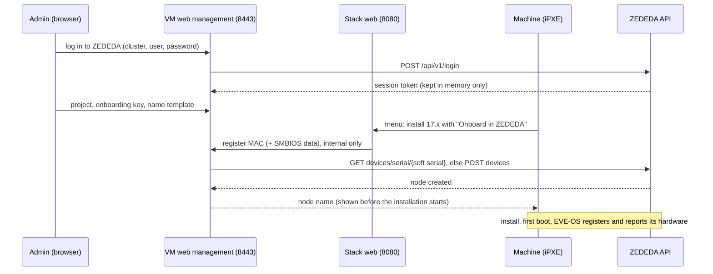

# Design: onboarding installed nodes in ZEDEDA

Status: **draft**, branch `feature/zededa-onboarding`. Nothing of this is in a
release.

## Goal

A machine that is installed from the boot menu shows up in ZEDEDA as an edge
node without anyone typing its serial number into the ZEDEDA UI. Optional, off
by default, VM appliance only (it needs the web management).

## What we know

### EVE-OS

- At first boot EVE-OS registers with the controller, signed with the
  onboarding certificate from the installer ISO, and sends its hardware
  serial, soft serial and device certificate
  ([REGISTRATION.md](https://github.com/lf-edge/eve/blob/master/docs/REGISTRATION.md)).
  It keeps retrying until the controller knows the node, so registering the
  node after the installation started is fine.
- The installer takes the soft serial from the kernel option
  `eve_soft_serial=`, otherwise from an existing `/config/soft_serial`,
  otherwise a random `uuidgen` (`pkg/installer/install`). The boot menu
  already passes `eve_soft_serial=<MAC address>` (`EVE_DEFAULT_SOFT_SERIAL=1`,
  the default), so **the boot server knows the soft serial when the machine
  boots**.
- The hardware serial is in SMBIOS; iPXE has it as `${serial}` (also
  `${uuid}`, `${manufacturer}`, `${product}`). Often useless on whitebox
  hardware ("To Be Filled By O.E.M.", "Default string", empty).
- The device certificate is created on the target (TPM if present) during the
  installation or at first boot. A network installation never gets it back
  (the installer only copies it to a USB INVENTORY partition or
  `/persist/installer` on the target), so the certificate method does not fit.

### ZEDEDA: model-less onboarding (EVE-OS 17.0.0-lts and later)

From [Onboard an Edge Device without selecting a Model](https://help.zededa.com/hc/en-us/articles/49766325180443--Optional-Onboard-an-Edge-Device-without-selecting-a-Model):

- Create the node with a name, project, serial number (the soft serial) and
  onboarding key; no brand or model. EVE-OS reports adapters, storage and
  hardware identity itself when it connects.
- Default onboarding key `5d0767ee-0547-4569-b530-387e526f8cb9`; an
  enterprise can have its own.
- Needs SysManager or SysAdmin.
- **The project must not have an application policy** (nor the deployment, if
  the node gets a deployment tag); ZEDEDA rejects the node otherwise.
- EVE-OS older than 17.0.0-lts cannot report its hardware: the node stays
  offline with an error that does not clear. The boot server knows the version
  of every image, so it only offers onboarding for 17.0.0-lts and later.
- After the node is online, its adapters still have to be assigned to network
  instances (*Adapters* tab).

### ZEDEDA API

From the Swagger definitions at `https://zedcontrol.<cluster>/api/v1/docs/`
(Edge Node Service, IAM/User Service):

- `POST /api/v1/login` with `usernameAtRealm` (or `username` + `realm`),
  `password`, `enterpriseName` → `token: {base64, expires}`.
- Every call: header `Authorization: Bearer <token.base64>`.
- `POST /api/v1/logout` ends the session; `PUT /api/v1/sessions/refresh`
  extends it.
- `POST /api/v1/devices` creates a node (`DeviceConfig`: `name`, `title`,
  `projectId`, `modelId`, `serialno`, `obkey`?, `tags`, `adminState`,
  `deploymentTag`, ...).
- `GET /api/v1/devices/serial/{serialno}` finds a node by serial (to avoid
  duplicates); `GET /api/v1/devices/name/{name}/status` for its state.
- Adapter fields in the definitions are marked "(model-less devices)".

## Proposed architecture

1. **Login, in memory only.** The web management gets a *ZEDEDA onboarding*
   page: cluster (default `zedcloud.zededa.net`), username, password,
   enterprise. The password is used for the login only; the session token is
   kept in the memory of the `eve-netboot web` process. Never on disk, never
   in exports or diagnostics. It is gone after a restart, a reboot or its
   expiry; then onboarding stops until someone logs in again. Alternatively a
   pasted session token (for SSO users, who cannot use `/login`).
2. **Settings** (stored, not secret): cluster, project, onboarding key
   (default filled in), name template (`eve-{mac}`), title template, tags,
   activate on creation. Stored like the other settings and part of the export.
3. **Boot menu.** While a session is active and for images of EVE-OS 17.0.0-lts
   and later: an installation option *Onboard in ZEDEDA* (on by default when
   logged in). The summary shows the node name and the project.
4. **Registration when `i` is pressed.** iPXE requests
   `http://SERVER:8080/eve/onboard?mac=${mac:hexhyp}&serial=${serial:uristring}&...`.
   The stack's web container passes that one path on to the management
   process (internal port, localhost only). The management process looks the
   node up by serial and creates it if needed, then answers with a short iPXE
   script that sets the result for the summary.
5. **Overview.** The page lists the nodes it created, with their state from
   ZEDEDA.

## Safety

- The token can do whatever the user can: a **dedicated local ZEDEDA user**
  with only SysManager, used for nothing else, e.g. `eve-netboot-onboarding`.
- The onboard request comes over plain HTTP from the LAN. Limits: only create,
  never change or delete; one node per MAC address; a rate limit; only while
  logged in; only for the configured project. Optional allow-list of MAC
  prefixes.
- The node name is built from a template with the MAC address; nothing the
  client sends goes into the API unchecked (strict character set).

## Open questions

1. Does `POST /api/v1/devices` accept a node **without `modelId`** (the
   definition still marks it required)? And is the onboarding key `obkey`?
   Needs one test call against a real enterprise.
2. Does ZEDEDA match the **soft serial** in `serialno` (the article says so for
   model-less onboarding), or also the hardware serial? Which one when both
   exist?
3. Token lifetime: how long does a session last, and is `sessions/refresh`
   allowed to keep it alive while the page is open?
4. One project for everything, or a choice per boot (menu) or per ISO?
5. Should the plain Docker Compose stack get this too? It has no management
   process to hold the token, so not in the first version.
6. Later: per-device data from a CSV (name, project, tags, deployment tag,
   static IP via adapter config), Edge View, Edge Sync.

## Plan

1. Answer question 1 and 2 with a test user and a project without application
   policy: one create, one lookup, one delete.
2. API client + in-memory session in the web management (unit-tested with a
   fake API).
3. Settings, page, boot menu option, onboard endpoint.
4. A test version `v1.7.0-rc.1` from this branch (a GitHub pre-release: never
   offered as an update), tested on real hardware.
