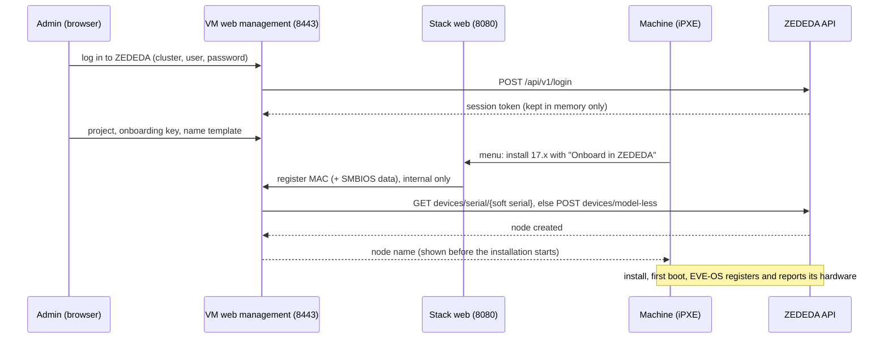

# Design: onboarding installed nodes in ZEDEDA

Status: **draft**, branch `feature/zededa-onboarding`. Nothing of this is in a
release.

## Goal

Install EVE-OS on a number of machines at the same time over the network, and
have them onboarded in the controller in the same go.

Today every node has to be added in ZEDEDA by hand with its serial number. The
hardware serial has to be found on each machine (label, BIOS); a soft serial
is even harder: you have to know which soft serial ended up on which machine,
which means checking each machine's console after the installation. With this
feature nobody has to look up a serial number at all:

- the boot menu gives every machine its MAC address as soft serial, and the
  boot server knows that MAC address when the machine boots;
- the boot server creates the edge node in ZEDEDA with that serial when the
  installation starts, so the node is waiting when EVE-OS registers;
- all nodes go into one **onboarding project** (a project without an
  application policy, which model-less nodes need). Once they are online you
  move them to the project they belong in;
- the web management lists which MAC address, hardware serial and product
  became which node, so you can tell the machines apart before moving them.

Optional, off by default, VM appliance only (it needs the web management,
where the ZEDEDA session lives).

## What we know

### EVE-OS

- At first boot EVE-OS registers with the controller, signed with the
  onboarding certificate from the installer ISO, and sends its hardware
  serial, soft serial and device certificate
  ([REGISTRATION.md](https://github.com/lf-edge/eve/blob/master/docs/REGISTRATION.md)).
  It keeps retrying until the controller knows the node, so registering the
  node after the installation started is fine.
- The installer takes the soft serial from the kernel option
  `eve_soft_serial=`, otherwise from an existing `/config/soft_serial`,
  otherwise a random `uuidgen` (`pkg/installer/install`). The boot menu
  already passes `eve_soft_serial=<MAC address>` (`EVE_DEFAULT_SOFT_SERIAL=1`,
  the default), so **the boot server knows the soft serial when the machine
  boots**.
- The hardware serial is in SMBIOS; iPXE has it as `${serial}` (also
  `${uuid}`, `${manufacturer}`, `${product}`). Often useless on whitebox
  hardware ("To Be Filled By O.E.M.", "Default string", empty).
- The device certificate is created on the target (TPM if present) during the
  installation or at first boot. A network installation never gets it back
  (the installer only copies it to a USB INVENTORY partition or
  `/persist/installer` on the target), so the certificate method does not fit.

### ZEDEDA: model-less onboarding (EVE-OS 17.0.0-lts and later)

From [Onboard an Edge Device without selecting a Model](https://help.zededa.com/hc/en-us/articles/49766325180443--Optional-Onboard-an-Edge-Device-without-selecting-a-Model):

- Create the node with a name, project, serial number (the soft serial) and
  onboarding key; no brand or model. EVE-OS reports adapters, storage and
  hardware identity itself when it connects.
- Default onboarding key `5d0767ee-0547-4569-b530-387e526f8cb9`; an
  enterprise can have its own.
- The article names SysManager or SysAdmin; a custom role with only
  **Edge Nodes: Create** (+ **Read**) should be enough for what we call (see
  *Safety*).
- **The project must not have an application policy** (nor the deployment, if
  the node gets a deployment tag); ZEDEDA rejects the node otherwise.
- EVE-OS older than 17.0.0-lts cannot report its hardware: the node stays
  offline with an error that does not clear. The boot server knows the version
  of every image, so it only offers onboarding for 17.0.0-lts and later.
- After the node is online, its adapters still have to be assigned to network
  instances (*Adapters* tab).

### ZEDEDA API

From the Swagger definitions at `https://zedcontrol.<cluster>/api/v1/docs/`
(Edge Node Service, IAM/User Service):

- `POST /api/v1/login` with `usernameAtRealm` (or `username` + `realm`),
  `password`, `enterpriseName` → `token: {base64, expires}`.
- Every call: header `Authorization: Bearer <token.base64>`.
- `POST /api/v1/logout` ends the session; `PUT /api/v1/sessions/refresh`
  extends it.
- `POST /api/v1/devices` creates a node (`DeviceConfig`: `name`, `title`,
  `projectId`, `modelId`, `serialno`, `obkey`?, `tags`, `adminState`,
  `deploymentTag`, ...).
- `GET /api/v1/devices/serial/{serialno}` finds a node by serial (to avoid
  duplicates); `GET /api/v1/devices/name/{name}/status` for its state.
- Adapter fields in the definitions are marked "(model-less devices)".

### Tested (2026-10-14, cluster `zedcontrol.thor.zededa.dev`, `docs/design/zededa_api_probe.py`)

- `POST /api/v1/login` with `usernameAtRealm`/`username`, `password`,
  `enterpriseName` works for a local user; the session lasts **4 hours**
  (`token.expires`, nanoseconds since 1970). `PUT /api/v1/sessions/refresh`
  answers 200 (`token.expires` 0 in the answer: to check whether it extends).
  A wrong password answers 401 `CREDENTIAL_MISMATCH` with
  `noOfLoginAttemptsLeft: 0`, yet the next login with the right password
  worked without unlocking anything: do not read that field as "locked";
  show the controller's answer as it is.
- `POST /api/v1/devices` **without `modelId` fails**: 400 `Invalid Model`.
- **`POST /api/v1/devices/model-less`** (not in the published definitions; the
  ZEDEDA UI uses it when no model is chosen) with the same `DeviceConfig`
  minus `modelId` **works**: 200, node created.
- The onboarding key is the field **`obkey`**; ZEDEDA stores it as
  `<key>:<serial>`. `serialno` is stored as given; `modelId` empty,
  `utype` `UNSPECIFIED`.
- `adminState: ADMIN_STATE_INACTIVE` was sent; the node came back as
  `ADMIN_STATE_CREATED`.
- `GET /api/v1/devices/serial/{serialno}` finds it (duplicate check);
  `DELETE /api/v1/devices/id/{id}` removes it (then 404).

## Proposed architecture

1. **Login, in memory only.** The web management gets a *ZEDEDA onboarding*
   page: cluster (default `zedcloud.zededa.net`), username, password,
   enterprise. The password is used for the login only; the session token is
   kept in the memory of the `eve-netboot web` process. Never on disk, never
   in exports or diagnostics. It is gone after a restart, a reboot or its
   expiry; then onboarding stops until someone logs in again. Alternatively a
   pasted session token (for SSO users, who cannot use `/login`).
2. **Settings** (stored, not secret): cluster, project, onboarding key
   (default filled in), name template (`eve-{mac}`), title template, tags,
   activate on creation. Stored like the other settings and part of the export.
3. **Boot menu, only for images of EVE-OS 17.0.0-lts and later.** Their
   summary becomes a small iPXE menu: the summary lines, the line *ZEDEDA:
   will be registered as <name> in project <project>* (or why not), **Install
   now [i]** and **Onboard in ZEDEDA: on/off [o]** (on by default). Not among
   the general installation options: those are chosen before the image, and
   the option must only exist for EVE-OS 17+. The summary of older images is
   unchanged and says nothing about ZEDEDA.
4. **Registration when `i` is pressed.** iPXE requests
   `http://SERVER:8080/eve/onboard?mac=${mac:hexhyp}&serial=${serial:uristring}&...`.
   The stack's web container passes that one path on to the management
   process (internal port, localhost only). The management process looks the
   node up by serial and creates it if needed, then answers with a short iPXE
   script that sets the result for the summary.
5. **Overview.** The page lists the nodes it created, with their state from
   ZEDEDA.

## Safety

- The token can do whatever the user can: a **dedicated local ZEDEDA user**,
  used for nothing else, with a custom role that may only create edge nodes:
  - login/logout: no right needed;
  - `POST devices/model-less`: **Edge Nodes: Create** (required);
  - `GET devices/serial/{serial}`: **Edge Nodes: Read** (optional: without it
    the duplicate check is skipped and a 409 on create counts as "exists");
  - `GET projects/name/{name}`: reading projects (optional: give the
    project's ID in `ZEDEDA_PROJECT` and it is not looked up).
  To be confirmed with such a role (probe script).
- The onboard request comes over plain HTTP from the LAN. Limits: only create,
  never change or delete; one node per MAC address; a rate limit; only while
  logged in; only for the configured project. Optional allow-list of MAC
  prefixes.
- The node name is built from a template with the MAC address; nothing the
  client sends goes into the API unchecked (strict character set).

## Roadmap

- **EVE-OS older than 17:** onboarding with a hardware model chosen for a
  batch of identical machines (`POST /api/v1/devices` with `modelId`). ZEDEDA
  requires the machine to match the model exactly, including network and IO
  adapters, and the boot server cannot check that beforehand; so only for
  batches of the same hardware, with the model shown in the summary.

## Open questions

1. ~~Node without a model / onboarding key field~~: answered, see *Tested*.
   The model-less endpoint is unpublished, so it may change; the client must
   report its errors clearly.
2. Does ZEDEDA match the **soft serial** in `serialno` (the article says so for
   model-less onboarding), or also the hardware serial? Which one when both
   exist?
3. Token lifetime: how long does a session last, and is `sessions/refresh`
   allowed to keep it alive while the page is open?
4. One project for everything, or a choice per boot (menu) or per ISO?
5. Should the plain Docker Compose stack get this too? It has no management
   process to hold the token, so not in the first version.
6. Later: per-device data from a CSV (name, project, tags, deployment tag,
   static IP via adapter config), Edge View, Edge Sync.

## Plan

1. ~~Answer question 1 with a test user~~ (done). Question 2 (soft serial
   matching) is answered by a real installation with the feature.
2. API client + in-memory session in the web management (unit-tested with a
   fake API).
3. Settings, page, boot menu option, onboard endpoint.
4. A test version `v1.7.0-rc.1` from this branch (a GitHub pre-release: never
   offered as an update), tested on real hardware.
