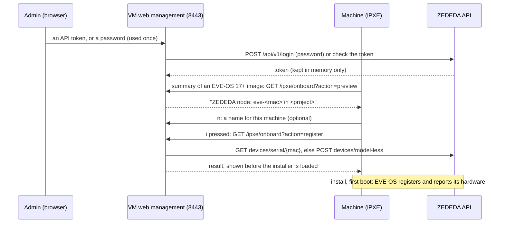

# ZEDEDA onboarding: design

How the VM appliance onboards the machines it installs in ZEDEDA, and the
EVE-OS and ZEDEDA behaviour it relies on. For using it, see
[vm/README.md: Onboard installed machines in ZEDEDA](../../vm/README.md#onboard-installed-machines-in-zededa).

## Goal

Install EVE-OS on a number of machines at the same time over the network, and
have them onboarded in the controller in the same go.

Without this, every node has to be added in ZEDEDA by hand with its serial
number. The hardware serial has to be found on each machine (label, BIOS); a
soft serial is even harder: you have to know which soft serial ended up on
which machine, which means checking each machine's console after the
installation. With this feature nobody has to look up a serial number at all:

- the boot menu gives every machine its MAC address as soft serial, and the
  boot server knows that MAC address when the machine boots;
- the boot server creates the edge node in ZEDEDA with that serial when the
  installation starts, so the node is waiting when EVE-OS registers;
- all nodes go into one **onboarding project** (a project without an
  application policy, which nodes without a model need). Once they are online
  you move them to the project they belong in;
- the web management lists which MAC address, hardware serial and product
  became which node, so you can tell the machines apart before moving them.

Optional, off by default, VM appliance only: it needs the web management,
where the ZEDEDA session lives.

## EVE-OS

- At first boot EVE-OS registers with the controller, signed with the
  onboarding certificate from the installer ISO, and sends its hardware
  serial, soft serial and device certificate
  ([REGISTRATION.md](https://github.com/lf-edge/eve/blob/master/docs/REGISTRATION.md)).
  It keeps retrying until the controller knows the node, so a node created
  while the installation runs is in time.
- The installer takes the soft serial from the kernel option
  `eve_soft_serial=`, otherwise from an existing `/config/soft_serial`,
  otherwise a random `uuidgen` (`pkg/installer/install`). The boot menu passes
  `eve_soft_serial=<MAC address>` (`EVE_DEFAULT_SOFT_SERIAL=1`, the default),
  so **the boot server knows the soft serial when the machine boots**.
- The hardware serial is in SMBIOS; iPXE has it as `${serial}` (also
  `${product}`). It is often a placeholder on whitebox hardware ("To Be Filled
  By O.E.M.", "Default string", empty); it is only used for the overview and,
  when real, for the `{serial}` placeholder of the node name.
- The device certificate is created on the target (in the TPM when there is
  one) during the installation or at first boot. A network installation never
  gets it back (the installer only copies it to a USB INVENTORY partition or
  `/persist/installer` on the target), so certificate-based onboarding does
  not fit.

## ZEDEDA

### Nodes without a model (EVE-OS 17.0.0-lts and later)

From [Onboard an Edge Device without selecting a Model](https://help.zededa.com/hc/en-us/articles/49766325180443--Optional-Onboard-an-Edge-Device-without-selecting-a-Model):

- The node is created with a name, project, serial number (the soft serial)
  and onboarding key; no brand or model. EVE-OS reports adapters, storage and
  hardware identity itself when it connects.
- Default onboarding key `5d0767ee-0547-4569-b530-387e526f8cb9` (the one of
  the EVE-OS images on GitHub); an enterprise can have its own.
- **The project must not have an application policy** (nor the deployment,
  when the node gets a deployment tag); ZEDEDA refuses the node otherwise.
- EVE-OS older than 17.0.0-lts cannot report its hardware: such a node stays
  offline with an error that does not clear. The boot server knows the version
  of every image, so it offers onboarding only for 17.0.0-lts and later.
- Once the node is online, its adapters are assigned to network instances
  (*Adapters* tab).

### API

From the API definitions at `https://zedcontrol.<cluster>/api/v1/docs/` and
the behaviour of the API:

| Call | Use | Notes |
|---|---|---|
| `POST /api/v1/login` | log in | `usernameAtRealm` / `username`, `password`, `enterpriseName` → `token: {base64, expires}`; `expires` in nanoseconds since 1970, a session lasts 4 hours. A wrong password answers 401 `CREDENTIAL_MISMATCH`, also with `noOfLoginAttemptsLeft: 0`, while the next correct login still works: the answer is shown as it is, never read as "locked". |
| `GET /api/v1/sessions/self` | check a pasted token | |
| `POST /api/v1/logout` | log out | |
| `GET /api/v1/projects/name/{name}` | project ID and policies | not called when the project is given by its ID |
| `GET /api/v1/devices/serial/{serialno}` | duplicate check | 404 = no such node |
| `DELETE /api/v1/devices/id/{id}` | delete a node this appliance created | 404 = already gone |
| `POST /api/v1/devices/model-less` | create the node | the `DeviceConfig` of `POST /api/v1/devices` without `modelId` (that call answers 400 `Invalid Model` without one). Not in the published definitions; it is the call the ZEDEDA UI uses for a node without a model, so errors are shown as the controller words them. The onboarding key goes in **`obkey`** (stored as `<key>:<serial>`), the soft serial in `serialno`. |

Every call after the login carries `Authorization: Bearer <token.base64>`.

## Architecture



1. **Settings** (`ZEDEDA_*`, VM settings, part of exports; none of them
   secret): `ZEDEDA_ONBOARDING` (off by default), `ZEDEDA_CLUSTER`
   (`zedcontrol.zededa.net`), `ZEDEDA_ENTERPRISE` and `ZEDEDA_USER` (only for
   a login with a password),
   `ZEDEDA_PROJECT` (name or ID), `ZEDEDA_ONBOARDING_KEY` (the default key),
   `ZEDEDA_NODE_NAME` (the naming convention, `eve-{mac}`) and
   `ZEDEDA_NODE_NEXT` (the next sequence number, `1`). The same group in the
   console menu and the web management. With onboarding on, the stack gets
   `ENI_ONBOARD_URL`, the address the boot menu calls.
2. **Node names.** ZEDEDA cannot rename a node, so the name is fixed when it
   is created. The naming convention has `{mac}`, `{serial}` (the hardware
   serial when it is real, else the MAC address) and `{n}` / `{n:3}` (a
   sequence number, zero-padded to that width). Registrations are handled one
   at a time; a number is taken only when a node is created, and
   `ZEDEDA_NODE_NEXT` goes up by one, so machines installed at the same time
   get different numbers and a re-installed machine uses none. The summary
   shows the next number as a preview. A name typed in the boot menu (key
   **n**, sent as `name=`) replaces the convention for that machine and takes
   no number. Every name is reduced to lower case letters, digits and
   hyphens, at most 63 characters.
3. **Login, in memory only.** With a pasted **API token** (or session token)
   nothing else is needed; it is checked with `GET sessions/self`, where only
   401 rejects it (an API token that may not read its session is taken as
   it is). With a **password**, the user and enterprise from the settings
   log in through `POST /api/v1/login` (local users only; single sign-on
   users use a token); the password is used for that request only. The
   token is kept in the memory of the `eve-netboot web` process: never on
   disk, in exports, diagnostics or logs. It is gone after a restart and when
   it expires; onboarding then stops until someone logs in again. The project
   is looked up once at login (skipped for an ID); a project with an
   application policy or deployment gives a warning.
4. **Boot menu, only for images of EVE-OS 17.0.0-lts and later.** Their
   summary is a small iPXE menu: the summary lines, the line *ZEDEDA: will be
   ZEDEDA node: <name> in <project>* (or why not), **Install now [i]**,
   **Onboard in ZEDEDA: on/off [o]** (on by default; only with the soft
   serial on) and **Node name [n]**. It is not among the general installation options, which are
   chosen before the image. The summary of older images is unchanged and says
   nothing about ZEDEDA.
5. **Registration.** iPXE has no TLS, so the web management serves one
   plain-HTTP path on its own port: `GET /ipxe/onboard`. Its TLS server peeks
   at the first bytes of a connection; only a request for this path is served
   without TLS, any other plain-HTTP request is redirected to HTTPS. `preview`
   only reports what will happen; `register` (after **i**) looks the node up
   by serial and creates it when it is not there. A machine this appliance
   registered before is answered from its own list without an API call. A
   refused duplicate (409) is checked by serial: the same machine, or a name
   already in use (reported as such); without the right to read nodes it is
   reported as "already registered, or the name is in use". The answer is a short iPXE
   script that sets `eve_ob_ok` and `eve_ob_s` (ASCII, a strict character set).
   A failed registration is shown in red; the installation continues and the
   node can be added by hand.
6. **The list of onboarded machines** (`/etc/eve-netboot/zededa-onboarded.json`,
   no secrets, survives restarts, the newest 200): time, node name and ID,
   project, MAC address, product and hardware serial, and the result
   (created, already there, failed with the controller's message, deleted).
   The web management and the console show it; *Export* gives it as CSV
   (`GET /api/zededa/export`); *Delete* deletes a node in ZEDEDA
   (`POST /api/zededa/delete`), only for nodes in the list, while logged in.
7. **Console.** The console menu has the same *ZEDEDA onboarding* screen:
   settings, login/logout, the list with delete, and the export (saved in the
   admin's home folder and on the SMB share). The session stays in the web
   management's process; the console uses it through the web management's
   API on `127.0.0.1` with a key the web management makes at every start and
   writes to `/run/eve-netboot-web.key` (memory, root only). The password typed
   in the console is passed on for the login only.

## Safety

- The token can do whatever its user can, so a **dedicated ZEDEDA user**
  is used for nothing else, with a custom role that may only create (and read)
  edge nodes:

  | Call | Right |
  |---|---|
  | login, logout, session check | none |
  | `POST devices/model-less` | **Edge Nodes: Create** (required) |
  | `GET devices/serial/{serial}` | **Edge Nodes: Read** (optional: without it the duplicate check is skipped, and a refused duplicate, 409, counts as already there) |
  | `GET projects/name/{name}` | reading projects (optional: with the project's ID in `ZEDEDA_PROJECT` it is not looked up) |
  | `DELETE devices/id/{id}` | **Edge Nodes: Delete** (optional: only to delete nodes from the appliance) |

- `/ipxe/onboard` is reachable over plain HTTP from the boot network. It can
  only create a node, never change or delete one; for a valid MAC address
  (`aa-bb-cc-dd-ee-ff`), once per MAC address (duplicate check), at most 60
  registrations a minute, only while someone is logged in, and only in the
  configured project. Logging out of ZEDEDA after a batch closes it.
- Delete and export need the admin login (or the console's local key, which
  is only accepted from `127.0.0.1`/`::1`); `/ipxe/onboard` can do neither.
- The node name is built from the naming convention or a typed name with the MAC address (or a real
  hardware serial) and reduced to lower case letters, digits and hyphens;
  nothing the client sends reaches the API unchecked.

## Roadmap

- **EVE-OS older than 17:** onboarding with a hardware model chosen for a
  batch of identical machines (`POST /api/v1/devices` with `modelId`). ZEDEDA
  requires the machine to match the model exactly, including network and IO
  adapters, and the boot server cannot check that beforehand; so only for
  batches of the same hardware, with the model shown in the summary.
- Per-device data from a list (name, project, tags, deployment tag, static IP
  through the adapter configuration), Edge View and Edge Sync settings.
- The plain Docker Compose installation: it has no management process to hold
  the session.

## Checking a ZEDEDA user

[zededa_api_probe.py](zededa_api_probe.py) checks that a ZEDEDA user and its
role can do what onboarding needs, against your own cluster. It asks for the
password (never shown or stored), logs in, looks up the project (or takes its
ID), creates one test node without a model, creates it a second time (the
answer to a duplicate), reads it back by serial, deletes it and logs out.
With a role that may not delete nodes it says so; delete the test node
(`eni-probe-…`) in ZEDEDA yourself.

```bash
python3 docs/design/zededa_api_probe.py --cluster zedcontrol.zededa.net --enterprise <enterprise> --user <user> --project <project name or ID>
```
