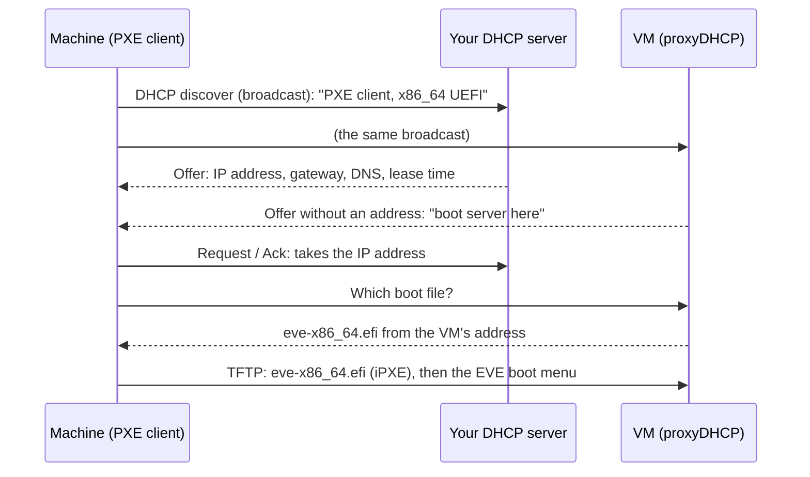

# DHCP configuration

A machine that boots from the network gets everything it needs at the start
from DHCP: an IP address (with gateway, DNS servers and lease time) and two
**boot settings**:

| Boot setting | Value |
|---|---|
| next-server / TFTP server (option 66, `siaddr`) | `SERVER_IP` |
| boot file name (option 67) | `eve-x86_64.efi` (x86_64 UEFI) or `eve-arm64.efi` (arm64 UEFI) |

There are three ways to hand out those boot settings:

| | Addresses come from | Boot settings come from | Change on your DHCP server | For |
|---|---|---|---|---|
| **A. Options on your DHCP server** | your DHCP server | your DHCP server | add the two options | Docker Compose and the VM, when you can change your DHCP server |
| **B. ProxyDHCP** (VM: *DHCP service → Proxy*) | your DHCP server | the VM | nothing | the VM next to a router or DHCP server you cannot or do not want to change. **Recommended for the VM.** |
| **C. DHCP server** (VM: *DHCP service → Server*) | the VM | the VM | there must be no other DHCP server | a network of its own just for installing machines |

Option A is described [below](#a-options-on-your-dhcp-server). B and C are
built into the [VM appliance](../vm/README.md#5b-or-let-the-vm-answer-dhcp-itself);
on another Docker Compose host you can run
[dnsmasq as proxyDHCP](#dnsmasq-as-proxydhcp-any-host) yourself.

## How proxyDHCP works

ProxyDHCP is part of the PXE standard and supported by the network boot
firmware of practically every UEFI machine. It splits the DHCP answer in two:
your own DHCP server keeps doing what it always does, and a second server,
the proxy, only adds the boot settings.



1. The machine asks for an address with a broadcast, marked as a PXE client
   and with its CPU architecture. **Both** servers in the network hear it.
2. Your DHCP server answers as for any other device: IP address, gateway, DNS
   servers, lease time.
3. The VM answers too, but **without an address**: only "I am the boot server".
4. The machine takes its address from your DHCP server, then asks the VM for
   the boot file (on UDP port 4011, or straight from the VM's first answer,
   depending on the firmware). The VM picks the file by architecture:
   `eve-x86_64.efi` or `eve-arm64.efi`, from its own address.
5. iPXE starts and asks DHCP again, with the same two answers. It takes the
   boot server from the proxy's answer (`${proxydhcp/next-server}`) and loads
   the EVE boot menu.

What this means in practice:

- **Your DHCP server stays in charge.** Addresses, reservations, gateway, DNS
  and lease times all keep coming from it. Nothing changes there.
- **It cannot conflict.** The proxy never hands out an address, and it only
  answers machines that network boot (PXE clients). Laptops, phones, printers
  and servers never notice it, and it is safe next to any DHCP server, also
  next to a router you cannot configure.
- **Same network.** The proxy needs to hear the broadcasts: put the VM in the
  same network (VLAN) as the machines. If DHCP requests are relayed between
  networks (`ip helper-address`, DHCP relay), add the VM's address as a second
  relay target.
- **No boot options on your DHCP server.** If your DHCP server already hands
  out a next-server or boot file name (options 66/67), many machines use that
  instead of the proxy's answer. Remove them when you switch to proxy.
- **Firewall:** the VM receives UDP 67 and 4011 (proxyDHCP) and TFTP (UDP 69
  and the random high UDP ports TFTP replies from). It has no firewall of its
  own; a firewall in the hypervisor must allow them. On ZEDEDA / EVE-OS, see
  [firewall rules on EVE-OS](../vm/README.md#firewall-rules-on-eve-os).
- **Check it:** on the VM, *Logs → DHCP* shows every network boot request and
  the answer. No lines when a machine boots means the broadcasts do not reach
  the VM.

### Proxy or server?

Use **Server** (option C) only when the network has no DHCP server at all,
for example a separate switch or VLAN just for installing machines. The VM
then hands out the addresses too and needs a fixed address itself. Never run
it in a network with a router or another DHCP server: two servers handing out
addresses give machines wrong addresses. Everywhere else, use **Proxy**.

## dnsmasq as proxyDHCP (any host)

The Docker Compose stack has no DHCP service of its own. On any Linux host in
the same network (it may be the Docker host) dnsmasq can be the proxy; this is
what the VM appliance runs. Replace `192.168.1.0` with your network and
`SERVER_IP` with the address of the EVE Netboot Installer:

```
port=0
log-dhcp
dhcp-range=192.168.1.0,proxy,255.255.255.0
pxe-service=BC_EFI,"EVE Netboot Installer",eve-x86_64.efi,SERVER_IP
pxe-service=X86-64_EFI,"EVE Netboot Installer",eve-x86_64.efi,SERVER_IP
pxe-service=ARM64_EFI,"EVE Netboot Installer",eve-arm64.efi,SERVER_IP
```

`port=0` turns off dnsmasq's DNS server, so only the proxy runs.

## A. Options on your DHCP server

If your DHCP server can match the client architecture (option 93), hand out
`eve-arm64.efi` to arch `0x000b` and `eve-x86_64.efi` to `0x0007`/`0x0009`.
Otherwise use `eve-x86_64.efi`.

Already using a boot file name for something else and want to switch without
touching DHCP? Set `IPXE_ALIASES_X86_64` (and/or `IPXE_ALIASES_ARM64`) to that
name; the iPXE binary is then also published under it. Make sure only one TFTP
server runs on the host.

### UniFi (Network application)

*Settings → Networks → (your network) → DHCP Service Management*:
enable **Network Boot**, server `SERVER_IP`, file `eve-x86_64.efi`.
Also set **TFTP Server** to `SERVER_IP`.

### dnsmasq

```
dhcp-match=set:efi-x86_64,option:client-arch,7
dhcp-match=set:efi-x86_64,option:client-arch,9
dhcp-match=set:efi-arm64,option:client-arch,11
dhcp-boot=tag:efi-x86_64,eve-x86_64.efi,,SERVER_IP
dhcp-boot=tag:efi-arm64,eve-arm64.efi,,SERVER_IP
```

### ISC dhcpd

```
option arch code 93 = unsigned integer 16;
next-server SERVER_IP;
if option arch = 00:0b { filename "eve-arm64.efi"; }
else                   { filename "eve-x86_64.efi"; }
```

### Kea

```json
"next-server": "SERVER_IP",
"client-classes": [
  { "name": "efi-arm64",  "test": "option[93].hex == 0x000b", "boot-file-name": "eve-arm64.efi" },
  { "name": "efi-x86_64", "test": "option[93].hex == 0x0007 or option[93].hex == 0x0009", "boot-file-name": "eve-x86_64.efi" }
]
```

### OPNsense / pfSense

*Services → DHCPv4 → (interface) → Network booting*: enable, next server
`SERVER_IP`, UEFI 64-bit file name `eve-x86_64.efi` (and the ARM file name
`eve-arm64.efi` where available).

### MikroTik RouterOS

```
/ip dhcp-server network set [find] next-server=SERVER_IP boot-file-name=eve-x86_64.efi
```

## Troubleshooting

- `tftp SERVER_IP -c get boot.ipxe` from another machine must work.
- The `tftp` service logs every request (`docker compose logs -f tftp`).
- Firewalls: allow UDP 69 *and* the ephemeral UDP ports TFTP replies from.
